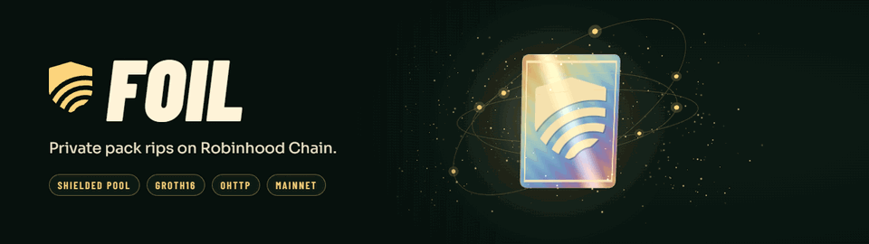
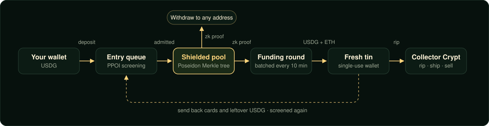
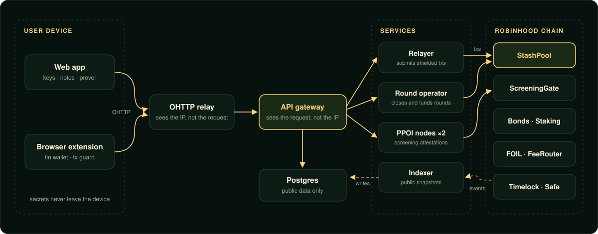

<a href="https://foilprivacy.com">
  <picture>
    <source srcset=".github/assets/banner.webp" type="image/webp" />
    
  </picture>
</a>

<p align="center">
  <a href="https://github.com/FoilRh/Foil/actions/workflows/ci.yml"></a>
  
  
  
  
  <a href="LICENSE"></a>
</p>

<p align="center">
  <a href="https://foilprivacy.com"><b>Website</b></a> ·
  <a href="apps/web/public/docs/foil-build.pdf"><b>Protocol spec</b></a> ·
  <a href="#mainnet-deployment"><b>Contracts</b></a> ·
  <a href="#security"><b>Security</b></a>
</p>

---

**Foil** is a privacy protocol for collectible pack rips on Robinhood Chain. Users hold USDG as
shielded notes in a zero-knowledge pool. When they want to rip a pack, the pool funds a fresh,
single-use wallet (a *tin*) inside a batched funding round, so nothing on-chain links the tin
back to the depositor. Cards and leftover USDG can be sent back into the pool, and funds can be
withdrawn to any address at any time.

> [!NOTE]
> Foil is live on mainnet in a **canary phase**: deposits are capped at **1,000 USDG** each and
> **500,000 USDG** in total. Exits are never pausable.

## Contents

- [How it works](#how-it-works)
- [Design guarantees](#design-guarantees)
- [Architecture](#architecture)
- [Repository layout](#repository-layout)
- [Getting started](#getting-started)
- [Testing and verification](#testing-and-verification)
- [Mainnet deployment](#mainnet-deployment)
- [Fees](#fees)
- [Security](#security)
- [License](#license)

## How it works

<p align="center"></p>

1. **Deposit.** USDG enters an entry queue. Proof-of-innocence (PPOI) nodes screen it against
   sanctions lists; only admitted deposits become leaves in the pool's Merkle tree.
2. **Shield.** Balances live as encrypted notes. Spending a note takes a Groth16 proof
   (`joinsplit`) that hides which leaf is spent and how much it holds.
3. **Request a tin.** A `tin_request` proof asks for a fixed-size funding. Requests are batched
   into rounds that close on a 10-minute boundary once at least 8 requests are in, or after
   30 minutes at the latest. Reveals are sorted, so the order of tins says nothing about requesters.
4. **Rip.** The round operator funds each tin with USDG and gas ETH in one transaction. The
   browser extension drives the tin on Collector Crypt and its transaction guard allows only the
   pack vault and the shipping payee as destinations.
5. **Return or exit.** Cards and leftover USDG go back through the entry queue; notes can be
   withdrawn to any address. Every exit path works while the protocol is paused.

## Design guarantees

| Property | How it is enforced |
| --- | --- |
| **Solvency** | Every pool function keeps `USDG.balanceOf(pool) >= totalIn - totalOut`, checked by Foundry invariant tests. |
| **Unpausable exits** | The guardian can pause new deposits and tin requests only, and only the timelock can unpause. Withdrawals, send-backs, `exitPending` and self-execution of a stalled round always stay open. |
| **Immutable core** | No proxies. The owner can change only bounded parameters, through a 24-hour `TimelockController` controlled by a 2-of-3 Safe. |
| **Unlinkability** | Keys, notes and proofs stay on the device. The database has no column linking two tins, a tin to a note, or a tin to an IP, and CI fails if one appears. |
| **Network privacy** | Every client request to the API is wrapped in Oblivious HTTP (RFC 9458), so the relay sees the IP but not the request, and the gateway sees the request but not the IP. |
| **Operator accountability** | Relayers and round operators post FOIL bonds that 3 of 5 attestors can slash for missed, censored or invalid rounds. |

## Architecture

<p align="center"></p>

- **Client.** Seed and keys are derived and stored on the device in an encrypted store. Proofs
  are generated in a Web Worker with snarkjs; nothing secret leaves the browser.
- **Services.** Stateless TypeScript services: a relayer that submits shielded transactions, a
  round operator that closes and executes funding rounds, two independent PPOI nodes that sign
  screening attestations, and an indexer that publishes public snapshots. Scheduling runs on
  `pg_cron`.
- **Contracts.** `StashPool` holds the notes and runs rounds, `ScreeningGate` admits screened
  entries, `Bonds` and `FoilStaking` secure operators, and `FeeRouter` splits protocol fees.

## Repository layout

| Path | Description |
| --- | --- |
| [`contracts/`](contracts) | Foundry project: `StashPool`, `ScreeningGate`, `Bonds`, `FOIL`, `FoilStaking`, `FeeRouter`, generated Groth16 verifiers, deploy and post-deploy check scripts |
| [`circuits/`](circuits) | circom 2 circuits (`joinsplit`, `tin_request`, `ppoi`), circuit tests and trusted-setup tooling |
| [`apps/web`](apps/web) | Next.js static web app and dashboard |
| [`apps/api`](apps/api) | API gateway (Hono + tRPC) with OHTTP decapsulation |
| [`apps/extension`](apps/extension) | Browser extension: tin wallet provider and transaction guard |
| [`services/`](services) | `relayer`, `round-operator`, `ppoi-node`, `indexer`, `ohttp-relay` |
| [`packages/client`](packages/client) | Key derivation, notes, prover, OHTTP transport, encrypted store |
| [`packages/protocol`](packages/protocol) | Shared constants, ABIs, zod schemas and base-unit money math |
| [`packages/guard`](packages/guard) | Transaction policy shared by the extension and the client |
| [`packages/ohttp`](packages/ohttp) | RFC 9458 Oblivious HTTP and RFC 9292 Binary HTTP |
| [`packages/db`](packages/db) | Drizzle schema and generated SQL migrations |
| [`e2e/`](e2e) | End-to-end tests against a local chain with every service running |

## Getting started

**Prerequisites:** [Bun](https://bun.sh) 1.3, [Foundry](https://getfoundry.sh), [circom](https://docs.circom.io) 2.1.

```sh
git clone https://github.com/FoilRh/Foil.git && cd Foil
git submodule update --init --recursive
bun install
```

Run the whole protocol locally (anvil, contracts with real verifiers, relayer, round operator,
API and OHTTP relay), then start the web app against it:

```sh
bun scripts/dev-stack.ts                 # terminal 1: local chain and services
cd apps/web && bun run dev               # terminal 2: dashboard on http://localhost:3000
```

The local stack uses anvil's public test keys and a mock USDG; it never touches a live network.

## Testing and verification

```sh
bun run test:unit          # TypeScript unit tests (client, services, API, extension)
bun run test:contracts     # Foundry unit, fuzz and invariant tests
bun run test:circuits      # circuit constraint tests
bun run test               # everything above plus the end-to-end suite
bun run lint:privacy       # privacy rules: schema, logs, OHTTP-only client traffic
```

Every push runs the full pipeline in [CI](.github/workflows/ci.yml): typecheck, lint and unit
tests, Foundry tests, circuit tests with real proofs, end-to-end tests, fork tests against
Robinhood Chain, and static analysis with Slither, Semgrep, circomspect and gitleaks.

## Mainnet deployment

Robinhood Chain (chain ID 4663). All contracts are source-verified on
[Sourcify](https://repo.sourcify.dev/4663); the full manifest is
[`contracts/deployments/4663.json`](contracts/deployments/4663.json).

| Contract | Address |
| --- | --- |
| StashPool | [`0xD129bb1CF465A53e51deD3047CAfA4Aa36CF330b`](https://robinhoodchain.blockscout.com/address/0xD129bb1CF465A53e51deD3047CAfA4Aa36CF330b) |
| ScreeningGate | [`0xAF2058a4043D3cb7DD6A420Dcf0eeF58FdeBA0ad`](https://robinhoodchain.blockscout.com/address/0xAF2058a4043D3cb7DD6A420Dcf0eeF58FdeBA0ad) |
| Bonds | [`0xEd500421dA2C5484c5a350F4E4fc278BE7A8465A`](https://robinhoodchain.blockscout.com/address/0xEd500421dA2C5484c5a350F4E4fc278BE7A8465A) |
| FOIL | [`0xb991Da91ac3DD884f077aeFdDC9a5Be661c345C8`](https://robinhoodchain.blockscout.com/address/0xb991Da91ac3DD884f077aeFdDC9a5Be661c345C8) |
| FoilStaking | [`0xaf61eDa7069C032dF43d682003d218057b9e4d94`](https://robinhoodchain.blockscout.com/address/0xaf61eDa7069C032dF43d682003d218057b9e4d94) |
| FeeRouter | [`0xF62A055ff1d5EA64Bc830Ba4618b98370401Fc7e`](https://robinhoodchain.blockscout.com/address/0xF62A055ff1d5EA64Bc830Ba4618b98370401Fc7e) |
| Timelock (owner, 24 h) | [`0x44867aef368E6F27808DF4dD0DBd8912A28DE732`](https://robinhoodchain.blockscout.com/address/0x44867aef368E6F27808DF4dD0DBd8912A28DE732) |
| Safe (2-of-3) | [`0x0527b13C69296A8400d19fd2B592847AFEB33f83`](https://robinhoodchain.blockscout.com/address/0x0527b13C69296A8400d19fd2B592847AFEB33f83) |

Verifier keys come from a Groth16 setup over BN254, built on the PSE Perpetual Powers of Tau
(contribution 80).

## Fees

| Action | Fee |
| --- | --- |
| Deposit into the pool | 0.15% |
| Withdraw from the pool | 0.25% |
| Fund a tin | 0.15% + $0.20, plus the tin's gas |

Protocol fees are split by `FeeRouter`: 80% to relayers and round operators, 10% to the treasury,
5% to FOIL stakers and 5% to the burn sink.

## Security

Please report vulnerabilities privately to **Foiltech@atomicmail.io**. Do not open a public
issue for anything that could put user funds at risk. The machine-readable contact is published
at [`/.well-known/security.txt`](https://foilprivacy.com/.well-known/security.txt).

Foil is new software running with capped deposits. Use it with amounts you can afford to lose.

## License

See [LICENSE](LICENSE).
